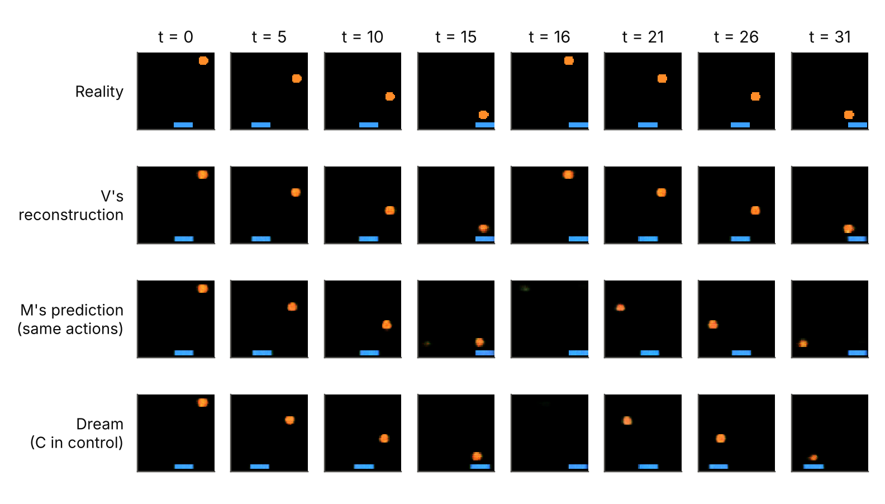
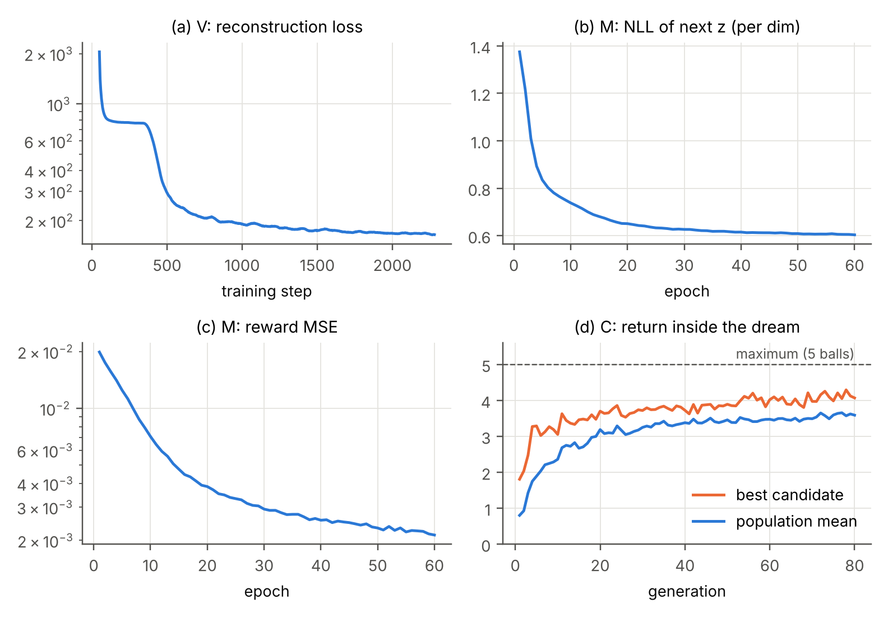
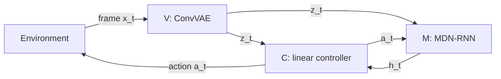

# World Model Primer

A hands-on introduction to world models: a complete, minimal and tested PyTorch implementation of a world-model agent, with a companion chapter that explains every line of it.

[](https://www.python.org/)
[](https://pytorch.org/)
[](LICENSE)

An agent that has learned a model of its environment can practise inside that model instead of the real world. This repository builds such an agent end to end, following the V-M-C design of Ha and Schmidhuber (2018):

- **V** (vision) is a convolutional variational autoencoder that compresses each 64x64 frame into 32 numbers.
- **M** (memory) is an MDN-RNN that predicts the next compressed frame and the reward.
- **C** (controller) is a linear policy with 289 parameters, trained with CMA-ES entirely inside M's "dream".

The dream-trained controller is then deployed in the real game, where it catches every ball in all 100 test episodes. The whole pipeline runs on a CPU in about 12 minutes.

The material is written for BSc and MSc students and practitioners with a basic to intermediate background in machine learning.

<p align="center">
  
</p>
<p align="center"><sub>Row 1: the real game played by the trained agent. Row 2: what the agent sees through V. Row 3: what M predicts for the same actions. Row 4: the agent playing inside its own dream.</sub></p>

## Contents

- [Highlights](#highlights)
- [Results](#results)
- [Repository structure](#repository-structure)
- [Getting started](#getting-started)
- [How it works](#how-it-works)
- [Configuration](#configuration)
- [Outputs](#outputs)
- [Reproducibility](#reproducibility)
- [Design notes and differences from the original paper](#design-notes-and-differences-from-the-original-paper)
- [Limitations](#limitations)
- [The companion chapter](#the-companion-chapter)
- [Further reading](#further-reading)
- [Contributing](#contributing)
- [Citation](#citation)
- [License](#license)
- [Acknowledgements](#acknowledgements)

## Highlights

- **The complete system in one readable file.** `world_model.py` (482 lines) contains the environment, data collection, V, M, C, training inside the dream, real-environment evaluation and a model-predictive planner. There are no hidden utilities.
- **Faithful to the original architecture.** V uses the same layer sizes as the paper's car-racing VAE and has exactly the same parameter count (4,348,547). M uses an LSTM with 256 units and 5 Gaussians per latent dimension, as in the paper.
- **No simulator dependencies.** The environment is a small NumPy game rendered as 64x64 RGB frames. It still contains the hard parts of a real task: pixel input, a random event, a sparse reward and the need to act ahead of time.
- **CPU friendly and reproducible.** Fixed seeds throughout. Two full runs on the same machine produced identical numbers.
- **Shows the main failure mode.** A controlled experiment shows a controller "cheating" an imperfect world model: a high score in the dream and a lower score than random in reality.
- **Documented in depth.** A 25-page chapter (PDF) covers the concepts, the maths, every code listing, the results and today's methods (Dreamer, MuZero, TD-MPC2, Genie, V-JEPA 2).

## Results

Balls caught per episode in the real game, out of a maximum of 5 (mean and standard deviation). All policies face the same sequence of balls.

| Policy | How it chooses actions | Balls caught |
| :-- | :-- | :-: |
| Random | random actions, each held for 1 to 8 steps | 1.37 ± 1.01 |
| **World model + C** | linear controller trained **only** in the dream | **5.00 ± 0.00** |
| World model + planning | cross-entropy method over imagined futures, no trained policy | 4.70 ± 0.56 * |
| Hand-coded | locates ball and paddle by colour and moves toward the ball | 5.00 ± 0.00 |

\* 20 episodes because planning is slower; all other rows use 100 episodes. Over 2,000 episodes the random policy averages 1.6.

**When does dream training transfer to reality?** `dream_experiments.py` evolves new controllers inside different world models and scores each one in the dream (500 dreams) and in the real game (100 episodes):

| World model M | Temperature | Score in the dream | Score in reality |
| :-- | :-: | :-: | :-: |
| trained on 20 episodes, 60 epochs | 1.15 | 5.65 | 1.12 ± 0.87 |
| trained on 300 episodes, 3 epochs | 1.15 | 5.02 | 1.12 ± 0.87 |
| trained on 300 episodes, 60 epochs (full) | 1.15 | 3.71 | 5.00 ± 0.00 |
| full | 0.10 | 4.06 | 4.94 ± 0.24 |
| full | 0.50 | 3.74 | 5.00 ± 0.00 |
| full | 1.00 | 3.76 | 5.00 ± 0.00 |
| full | 1.50 | 3.59 | 5.00 ± 0.00 |

With weak world models, the controllers reach their highest dream scores (5.65 is more than the 5 balls that exist) but catch fewer balls than a random policy in reality. Inspection shows one of them pushing the paddle against the right wall for most of each episode, a behaviour the weak model wrongly rewards. A higher dream score does not mean a better agent.

<p align="center">
  
</p>
<p align="center"><sub>Training curves. (a) V first outputs an empty frame, then learns to draw the paddle and ball. (b, c) M's prediction losses. (d) The controller's return inside the dream.</sub></p>

## Repository structure

```text
world-model-primer/
├── README.md
├── LICENSE
├── world_model.py           # the complete system: environment, V, M, C, planner, evaluation
├── dream_experiments.py     # experiments on world-model quality and dream temperature
├── make_figures.py          # reproduces the figures shown above and in the chapter
├── docs/
│   └── World_Models_PyTorch_Chapter.pdf
└── assets/
    ├── fig_dream.png
    └── fig_training.png
```

Running the scripts creates a `runs/` directory with trained models and logs. It does not need to be committed.

## Getting started

### Requirements

- Python 3.10 or newer
- PyTorch 2.x, NumPy, [`cma`](https://github.com/CMA-ES/pycma) (the CMA-ES optimiser)
- matplotlib, only for `make_figures.py`

Tested with Python 3.13, PyTorch 2.14.1, NumPy 2.5.3, cma 4.5.0 and matplotlib 3.11.2 on Linux.

### Installation

```bash
git clone https://github.com/<your-username>/world-model-primer.git
cd world-model-primer
python -m venv .venv
source .venv/bin/activate          # on Windows: .venv\Scripts\activate
pip install torch numpy cma matplotlib
```

### Quickstart

Train and evaluate the full agent:

```bash
python world_model.py
```

The run ends with a summary like this (from a 2-core cloud CPU):

```text
5) Testing in the real environment
   random policy                  1.37 +/- 1.01 balls caught (out of 5)
   world model + dream-trained C  5.00 +/- 0.00 balls caught (out of 5)
   world model + CEM planning     4.70 +/- 0.56 balls caught (out of 5)
   hand-coded policy              5.00 +/- 0.00 balls caught (out of 5)
Finished in 12.4 minutes. Models and logs saved to 'runs/'.
```

Then, optionally:

```bash
python dream_experiments.py        # the dream-versus-reality experiments (about 12 minutes)
python make_figures.py             # writes fig_training.png and fig_dream.png
```

Both scripts load the models that `world_model.py` saved in `runs/`, so run that first.

## How it works



At every step, V encodes the frame into `z_t`, C picks an action from `[z_t, h_t]`, and M updates its memory `h_t` with `(z_t, a_t)`. During dream training, the environment and V's encoder are switched off: M samples the next `z` and predicts the reward, and that sample becomes the next observation.

`world_model.py` runs five stages:

| Stage | What happens | Time on 2 CPU cores |
| :-- | :-- | :-: |
| 1. Collect | 300 random-policy episodes, 24,300 frames | 2 s |
| 2. Train V | convolutional VAE for 3 epochs, then encode every frame | 7.4 min |
| 3. Train M | MDN-RNN on latent sequences for 60 epochs | 42 s |
| 4. Train C | CMA-ES for 80 generations, 512 dreams in parallel per generation, no real environment | 76 s |
| 5. Test | the agent, a CEM planner and two baselines in the real game | 3.0 min |

The code is organised in the same order, with numbered section headers (`# 1. The environment` to `# 6. Put it all together`), so it can be read from top to bottom.

## Configuration

All hyperparameters live in the `Config` dataclass at the top of `world_model.py`. The most important ones:

| Field | Default | Meaning |
| :-- | :-: | :-- |
| `n_episodes` | 300 | random-policy episodes used to train V and M |
| `z_dim` | 32 | size of the latent code `z` |
| `vae_epochs` | 3 | VAE training epochs |
| `kl_tolerance` | 0.5 | "free bits": KL below 0.5 nats per dimension is not penalised |
| `hidden`, `n_mix` | 256, 5 | LSTM units and Gaussians per latent dimension in M |
| `rnn_epochs` | 60 | MDN-RNN training epochs |
| `temperature` | 1.15 | sampling temperature of the dream (higher is noisier) |
| `popsize`, `dream_rollouts`, `generations` | 32, 16, 80 | CMA-ES population, dreams per candidate, generations |
| `plan_horizon`, `plan_candidates`, `plan_iters` | 16, 100, 2 | settings of the CEM planner |

To change settings without editing the file:

```python
from world_model import Config, main

main(Config(generations=40, plan_episodes=5, out_dir="runs_quick"))
```

Note that `dream_experiments.py` and `make_figures.py` read from `runs/`.

## Outputs

| File | Contents |
| :-- | :-- |
| `runs/vae.pt` | weights of V |
| `runs/mdnrnn.pt` | weights of M |
| `runs/controller.pt` | the 289 parameters of C |
| `runs/log.json` | configuration, per-step VAE losses, per-epoch MDN-RNN losses, CMA-ES history, results and timings |
| `runs/dream_experiments.json` | results of `dream_experiments.py` |
| `fig_training.png`, `fig_dream.png` | figures written by `make_figures.py` |

## Reproducibility

- All randomness is seeded (`Config.seed`, default 0). The environment, the data, the training runs and the evaluations are deterministic on a given machine: two complete runs produced identical logs apart from wall-clock time.
- Every policy is evaluated on the same sequence of balls (evaluation seed 12345), so scores are directly comparable.
- Results on other hardware, thread counts or PyTorch builds can differ slightly because of floating-point differences. The qualitative conclusions should not change.
- The reported results and timings were produced on CPU. The code selects a CUDA GPU automatically when one is available.

## Design notes and differences from the original paper

- **Environment.** The paper used CarRacing and VizDoom. This repository uses a small Catch game so that the full pipeline runs on a CPU without simulator dependencies. As in the paper's VizDoom experiment, the controller is trained entirely inside the dream.
- **Reconstruction loss.** The paper trained V with squared error. Here V uses binary cross-entropy. On mostly black frames, squared error stayed stuck for several hundred steps producing empty images, while cross-entropy learned the ball and paddle sooner. The architecture and the KL floor ("free bits", as in the original code) are unchanged.
- **Reward head.** M also predicts the reward, which turns it into a complete simulator for this task. Episodes have a fixed length, so no "done" head is needed.
- **Population size.** CMA-ES uses 32 candidates per generation instead of 64, each scored on 16 dreams as in the paper.
- **Planning.** The model-predictive planner (cross-entropy method) is an addition that shows the second main way of using a world model. It is not part of the original paper.

## Limitations

- The environment is intentionally simple. Harder environments usually need iterative data collection with the improving agent, longer training and larger models.
- All results come from a single seed. Runs are deterministic, but seed-to-seed variation was not studied.
- The planner is evaluated on 20 episodes because it imagines 3,200 steps for every real step.
- The implementation favours readability over speed and is not intended as a benchmark baseline.

## The companion chapter

`docs/World_Models_PyTorch_Chapter.pdf` is a self-contained, 25-page reading for students. It covers:

1. What a world model is and why it helps
2. The reinforcement learning needed to follow the rest
3. The anatomy of a world model: perception, prediction, rewards, and acting by learning or planning
4. The V-M-C recipe and the original paper's results
5. The full implementation, printed listing by listing with explanations, plus results and experiments
6. How modern systems extend the same ideas: Dreamer, MuZero, TD-MPC2, IRIS, DIAMOND, Genie, Cosmos and V-JEPA 2
7. Practical lessons, exercises, curated resources and references

The code listings in the PDF are read directly from the files in this repository, and every number in it comes from running them.

## Further reading

- D. Ha and J. Schmidhuber, [World Models](https://worldmodels.github.io/) (interactive paper) and the [original code](https://github.com/hardmaru/WorldModelsExperiments)
- D. Hafner et al., [Mastering diverse control tasks through world models](https://arxiv.org/abs/2301.04104) (DreamerV3, Nature 2025)
- J. Schrittwieser et al., [Mastering Atari, Go, chess and shogi by planning with a learned model](https://arxiv.org/abs/1911.08265) (MuZero, Nature 2020)
- N. Hansen, H. Su and X. Wang, [TD-MPC2: Scalable, Robust World Models for Continuous Control](https://arxiv.org/abs/2310.16828) (ICLR 2024)
- M. Assran et al., [V-JEPA 2](https://arxiv.org/abs/2506.09985) (2025)
- J. Ding et al., [Understanding World or Predicting Future? A Comprehensive Survey of World Models](https://arxiv.org/abs/2411.14499)
- R. S. Sutton and A. G. Barto, *Reinforcement Learning: An Introduction*, 2nd edition, Chapter 8

## Contributing

Contributions that make the material clearer or more correct are welcome. Please open an issue to discuss larger changes before submitting a pull request.

When contributing code:

- Keep `world_model.py` self-contained and readable from top to bottom.
- Run `python world_model.py` and include the final results block in the pull request description.
- If a change affects results or figures, regenerate them with `dream_experiments.py` and `make_figures.py`.

## Citation

If this material helps your work, please cite the original paper:

```bibtex
@incollection{ha2018worldmodels,
  title     = {Recurrent World Models Facilitate Policy Evolution},
  author    = {Ha, David and Schmidhuber, J{\"u}rgen},
  booktitle = {Advances in Neural Information Processing Systems 31},
  pages     = {2451--2463},
  year      = {2018},
  url       = {https://worldmodels.github.io}
}
```

## License

This project is released under the [MIT License](LICENSE).

## Acknowledgements

This work builds on the World Models paper by David Ha and Jürgen Schmidhuber and on details of its [original implementation](https://github.com/hardmaru/WorldModelsExperiments), including the KL tolerance, the MDN loss and the sampling temperature. CMA-ES is provided by [pycma](https://github.com/CMA-ES/pycma), maintained by Nikolaus Hansen.
